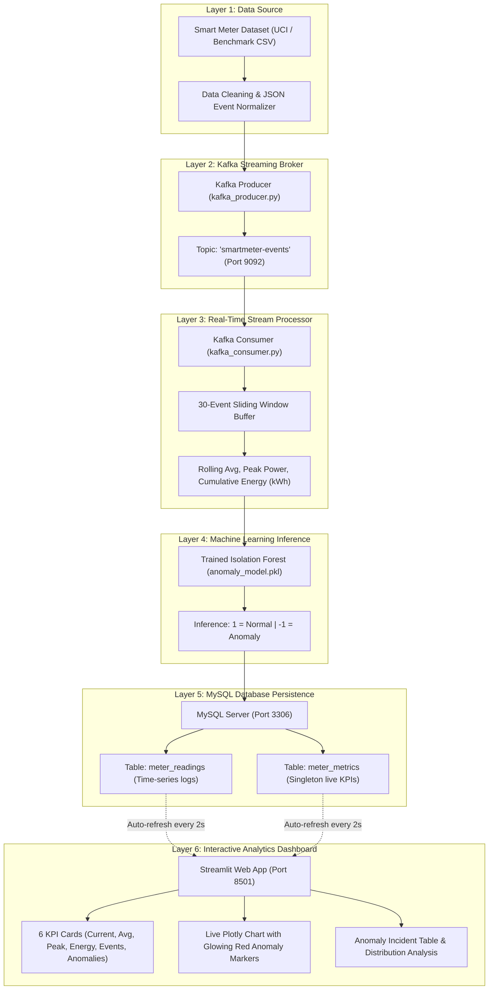

# Real-Time Smart Energy Monitoring and Anomaly Detection System

[](https://python.org)
[](https://kafka.apache.org)
[](https://mysql.com)
[](https://scikit-learn.org)
[](https://streamlit.io)
[](https://plotly.com)

An end-to-end, real-time Data Stream Analytics (DSA) academic project demonstrating continuous electricity consumption ingestion, sliding-window stream processing, unsupervised machine learning anomaly detection using Isolation Forest, persistent relational storage, and a responsive auto-refreshing dashboard.

---

## Table of Contents
1. [Project Overview](#project-overview)
2. [Problem Statement & Objectives](#problem-statement--objectives)
3. [Technology Stack](#technology-stack)
4. [Six-Layer System Architecture](#six-layer-system-architecture)
5. [Folder Structure](#folder-structure)
6. [Prerequisites & Environment Setup](#prerequisites--environment-setup)
7. [Database Configuration](#database-configuration)
8. [Machine Learning Model](#machine-learning-model)
9. [Step-by-Step Execution Workflow](#step-by-step-execution-workflow)
10. [Expected Outputs & Verification](#expected-outputs--verification)
11. [Troubleshooting Guide](#troubleshooting-guide)
12. [Project Report Reference](#project-report-reference)

---

## 1. Project Overview

Modern smart grids require low-latency analytics to monitor power consumption spikes, equipment failures, leakage, and uncharacteristic energy behavior. Traditional batch analytics fail to catch real-time surges before equipment overload or financial loss occurs.

This system simulates a continuous live smart meter feed, ingests high-velocity readings through **Apache Kafka**, executes real-time sliding window aggregation (30-event rolling average, peak power, cumulative energy integration in kWh), applies an unsupervised **Scikit-Learn Isolation Forest** model for anomaly detection, persists all events and stateful metrics to **MySQL**, and renders an interactive **Streamlit + Plotly** operational dashboard that auto-refreshes every 2 seconds.

---

## 2. Problem Statement & Objectives

### Problem Statement
Electricity consumption data exhibits significant temporal volatility, daily seasonal peaks, and occasional unpredictable surges due to device malfunctions, grid anomalies, or unauthorized consumption. Traditional static analysis tools process energy logs retroactively. The goal is to build an online stream analytics pipeline that flags anomalous consumption instantaneously with zero manual intervention.

### Core Objectives
- Stream electricity readings continuously as JSON events through Apache Kafka.
- Compute rolling metrics over a sliding window of the latest 30 events.
- Train and evaluate an Isolation Forest model with configurable contamination rate.
- Execute real-time ML inference on each incoming stream event.
- Maintain transactional consistency and persistence in MySQL tables.
- Visualize consumption trends, anomalies, and system health in a modern dashboard.

---

## 3. Technology Stack

| Component | Technology | Role |
| :--- | :--- | :--- |
| **Language** | Python 3.11+ | Core implementation across all layers |
| **Streaming Platform** | Apache Kafka 3.7.0 & ZooKeeper | Distributed pub-sub messaging broker |
| **Stream Processing** | Python Kafka Consumer & Collections Deque | 30-event sliding window, rolling mean, energy integration |
| **Machine Learning** | Scikit-learn (Isolation Forest) | Unsupervised anomaly detection on 2D feature space |
| **Model Persistence** | Joblib | Serialization/deserialization of `.pkl` artifact |
| **Database** | MySQL 8.0 Server | Relational storage for time-series logs and metrics |
| **Database Driver** | PyMySQL & Cryptography | Connection pooling and parameterized SQL execution |
| **Data Processing** | Pandas, NumPy | Cleaning, feature engineering, and matrix operations |
| **Dashboard** | Streamlit | Auto-refreshing web user interface |
| **Visualization** | Plotly Graph Objects & Express | Interactive multi-trace time-series and anomaly charts |
| **Environment Config** | Python-dotenv | Secure decoupled credentials management |

---

## 4. Six-Layer System Architecture



---

## 5. Folder Structure

```
smart-energy-monitoring/
│
├── config/
│   ├── __init__.py
│   └── settings.py              # Centralized environment & app settings
│
├── dashboard/
│   ├── __init__.py
│   └── app.py                   # Streamlit + Plotly interactive dashboard
│
├── database/
│   ├── __init__.py
│   ├── db_connection.py         # MySQL connection pooling & parameterized queries
│   └── schema.sql               # DDL for smartmeter database and tables
│
├── data/
│   └── smart_meter.csv          # Cleaned smart-meter electricity dataset
│
├── ml/
│   ├── __init__.py
│   └── train_model.py           # Isolation Forest training & evaluation script
│
├── models/
│   └── anomaly_model.pkl        # Serialized Isolation Forest model artifact
│
├── processor/
│   ├── __init__.py
│   └── kafka_consumer.py        # Stream processor, sliding window & ML inference
│
├── producer/
│   ├── __init__.py
│   └── kafka_producer.py        # Real-time Kafka event publisher with delay control
│
├── reports/
│   └── project_report.md        # Complete 15-section academic course project report
│
├── utils/
│   ├── __init__.py
│   └── data_preprocessing.py   # Dataset ingestion, cleaning, and conversion utilities
│
├── .env                         # Local environment configuration
├── .env.example                 # Environment configuration template
├── .gitignore                   # Version control ignore list
├── requirements.txt             # Pinned project dependencies
├── README.md                    # Project documentation and execution manual
└── main.py                      # Master command-line orchestrator
```

---

## 6. Prerequisites & Environment Setup

### Prerequisites
- **Python**: Version 3.11 or higher
- **Java**: JDK 17, 21, or 24 (ensure `JAVA_HOME` points to the JDK directory, e.g., `C:\Program Files\Java\jdk-24`)
- **Apache Kafka**: 3.x (installed at `C:\kafka`)
- **MySQL**: 8.0 Server (running on `localhost:3306`)

### Virtual Environment Setup
Open PowerShell and navigate to the project root:
```powershell
cd "C:\Users\Aswin Angras A\.gemini\antigravity-ide\scratch\smart-energy-monitoring"
```

Activate the project virtual environment:
```powershell
.\venv\Scripts\Activate.ps1
```

Install all required Python dependencies:
```powershell
pip install -r requirements.txt
```

---

## 7. Database Configuration

The application persists data into MySQL under the `smartmeter` database schema.

### Database Schema DDL
Execute `database/schema.sql` or run the automated master command:
```powershell
python main.py setup-db
```

### Table 1: `meter_readings`
Records every streamed and classified sensor reading:
```sql
CREATE TABLE meter_readings (
    reading_pk INT AUTO_INCREMENT PRIMARY KEY,
    reading_time DATETIME NOT NULL,
    global_active_power DOUBLE NOT NULL,
    rolling_avg_30 DOUBLE NOT NULL,
    is_anomaly INT NOT NULL DEFAULT 0,
    created_at TIMESTAMP DEFAULT CURRENT_TIMESTAMP,
    INDEX idx_reading_time (reading_time),
    INDEX idx_is_anomaly (is_anomaly)
);
```

### Table 2: `meter_metrics`
Maintains real-time aggregated metrics (singleton record `id=1`):
```sql
CREATE TABLE meter_metrics (
    id INT PRIMARY KEY DEFAULT 1,
    current_power DOUBLE NOT NULL DEFAULT 0.0,
    rolling_average DOUBLE NOT NULL DEFAULT 0.0,
    peak_power DOUBLE NOT NULL DEFAULT 0.0,
    total_energy DOUBLE NOT NULL DEFAULT 0.0,
    total_readings INT NOT NULL DEFAULT 0,
    total_anomalies INT NOT NULL DEFAULT 0,
    updated_at TIMESTAMP DEFAULT CURRENT_TIMESTAMP ON UPDATE CURRENT_TIMESTAMP
);
```

---

## 8. Machine Learning Model

- **Algorithm**: Isolation Forest (`sklearn.ensemble.IsolationForest`)
- **Type**: Unsupervised tree-based outlier isolation
- **Features**: `['global_active_power', 'rolling_avg_30']`
- **Contamination Rate**: `0.04` (4% expected anomalies)
- **Model Storage**: Serialized to `models/anomaly_model.pkl` via `joblib`

### Training the Model
Run the training script:
```powershell
python main.py train
```
**Actual Training Results**:
- Dataset: 29,996 records (UCI Household Electric Power dataset)
- Normal Readings (`1`): 28,796 records (96.00%) | Mean: 1.66 kW | Range: 0.19 kW - 5.20 kW
- Anomalous Readings (`-1`): 1,200 records (4.00%) | Mean: 4.77 kW | Range: 0.20 kW - 9.13 kW
- Model artifact written to: `models/anomaly_model.pkl`

---

## 9. Step-by-Step Execution Workflow

To run the complete system in live demonstration mode, open **4 separate terminal windows**:

### Terminal 1: Start Zookeeper & Kafka Broker
```powershell
# 1. Start Zookeeper (Port 2181)
cd C:\kafka
.\bin\windows\zookeeper-server-start.bat .\config\zookeeper.properties

# 2. In a parallel window, Start Kafka Broker (Port 9092)
cd C:\kafka
.\bin\windows\kafka-server-start.bat .\config\server.properties
```

### Terminal 2: Start Stream Processor (Kafka Consumer)
```powershell
cd "C:\Users\Aswin Angras A\.gemini\antigravity-ide\scratch\smart-energy-monitoring"
.\venv\Scripts\Activate.ps1
python main.py consumer
```
*Output: Listens for events on `smartmeter-events`, computes sliding window metrics, runs Isolation Forest predictions, and inserts into MySQL.*

### Terminal 3: Start Streamlit Dashboard
```powershell
cd "C:\Users\Aswin Angras A\.gemini\antigravity-ide\scratch\smart-energy-monitoring"
.\venv\Scripts\Activate.ps1
python main.py dashboard
```
*Dashboard will open at: `http://localhost:8501`.*

### Terminal 4: Start Kafka Event Producer
```powershell
cd "C:\Users\Aswin Angras A\.gemini\antigravity-ide\scratch\smart-energy-monitoring"
.\venv\Scripts\Activate.ps1
# Stream continuously with 0.5s delay
python main.py producer --delay 0.5
```

---

## 10. Expected Outputs & Verification

1. **Kafka Producer Console**:
   ```
   [Pub #00020] Timestamp: 2006-12-16 17:43:00 | Active Power: 3.728 kW | Voltage: 235.8 V | Intensity: 16.4 A
   ```
2. **Kafka Consumer Console**:
   ```
   [🚨 ANOMALY ALERT] Event #00024 | Time: 2006-12-16 17:47:00 | Power: 7.706 kW | Rolling-30 Avg: 4.561 kW | Peak: 7.71 kW | Total Energy: 2.605 kWh | Total Anomalies: 15
   ```
3. **MySQL Database Records**:
   ```sql
   mysql> SELECT * FROM meter_metrics;
   +----+---------------+-----------------+------------+--------------+----------------+-----------------+---------------------+
   | id | current_power | rolling_average | peak_power | total_energy | total_readings | total_anomalies | updated_at          |
   +----+---------------+-----------------+------------+--------------+----------------+-----------------+---------------------+
   |  1 |         4.474 |         4.56056 |      7.706 |       2.6045 |             35 |              15 | 2026-10-30 13:20:20 |
   +----+---------------+-----------------+------------+--------------+----------------+-----------------+---------------------+
   ```
4. **Streamlit Dashboard**:
   - 6 KPI cards update dynamically every 2 seconds.
   - Plotly chart visualizes the green active power line, cyan dashed 30-reading rolling average, and bright red circular scatter markers on anomalies.
   - Anomaly Incident table lists the recent flagged spikes with timestamps.

---

## 11. Troubleshooting Guide

| Issue | Root Cause | Solution |
| :--- | :--- | :--- |
| `'wmic' is not recognized` | Windows 11 (24H2+) deprecated `wmic.exe` | Edit `C:\kafka\bin\windows\kafka-server-start.bat` and set `set KAFKA_HEAP_OPTS=-Xmx1G -Xms1G` directly. |
| `The system cannot find the path specified` | `JAVA_HOME` had `\bin` appended | Set `JAVA_HOME=C:\Program Files\Java\jdk-24` (strip `\bin`). |
| `NoBrokersAvailable` | Kafka broker is not running on `localhost:9092` | Ensure Zookeeper (port 2181) and Kafka (port 9092) are started before running producer/consumer. |
| `Access denied for user 'root'@'localhost'` | MySQL password mismatch | Check `.env` and set `MYSQL_PASSWORD` to your local root password. |
| Port 8501 in use | Another Streamlit process is open | Run `streamlit run dashboard/app.py --server.port=8502`. |

---

## 12. Project Report Reference

A comprehensive 15-section academic project report structured according to Data Stream Analytics course standards is provided in:
[reports/project_report.md](file:///C:/Users/Aswin%20Angras%20A/.gemini/antigravity-ide/scratch/smart-energy-monitoring/reports/project_report.md)
